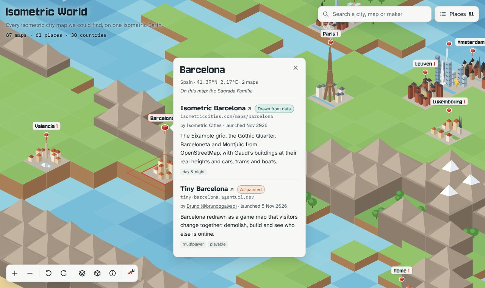

# Isometric World

**Live at [isometric.earth](https://isometric.earth)**

An isometric Earth with a little city for every isometric city map we could find: Isometric NYC, tiny.london, Tiny SP, Isometric Istanbul and over a hundred more. Each little city has its own landmark (the Eiffel Tower, the CN Tower, Christ the Redeemer, the Golden Gate Bridge…) and buildings in a local style. Click one and a card pops up with every map of that place, who made it and how.



In January 2026 Andy Coenen released [Isometric NYC](https://isometric.nyc/), all of New York redrawn tile by tile as SimCity 2000-style pixel art. People have since made maps of their own cities, by AI, from open data and as real-time 3D dioramas. This page collects them in one place, on a world drawn in the same isometric style.

## Run it

It is a static site with no build step. Serve the folder and open it:

```sh
git clone https://github.com/diocosta/isometric-world
cd isometric-world
python3 -m http.server 8000
# open http://localhost:8000
```

Opening `index.html` straight from disk does not work, because browsers do not let a page `fetch()` local files.

What you can do on the map:

- Click a city to open its card (on phones it slides up from the bottom; drag it down to close it). Hover a city to preview it.
- Search for a city, a map or a maker; pick a suggestion to fly there with that map highlighted.
- **Places** opens the full list, with filters for how the maps were made.
- Drag to pan, scroll or pinch to zoom, double-click to zoom in.
- Turn the world a quarter turn with the turn buttons, or <kbd>Q</kbd> and <kbd>E</kbd>.
- <kbd>0</kbd> shows the whole world, <kbd>R</kbd> flies to a random place, <kbd>/</kbd> jumps to the search box, <kbd>Esc</kbd> closes whatever is open.
- Every place has its own link, for example `#sao-paulo` or `#new-york`.

## Add a map

Every map is one object in [`data/projects.json`](data/projects.json). Add yours, then check the file:

```sh
node tools/check-data.mjs           # format checks; exits 1 on errors
node tools/check-data.mjs --links   # also fetches every link
```

```json
{
  "id": "tinysp",
  "name": "TinySP",
  "url": "https://tinysp.vercel.app/",
  "place": "São Paulo",
  "country": "Brazil",
  "lat": -23.551,
  "lon": -46.633,
  "by": "Lucas Guerras",
  "byUrl": "https://x.com/lucasguerras22",
  "launched": "2026-11",
  "technique": "ai",
  "status": "wip",
  "about": "São Paulo in pixel art from Avenida Paulista to Ibirapuera, with day and night tiles and a search for any place.",
  "tags": ["day & night", "searchable"],
  "links": [{ "label": "Source code", "url": "https://github.com/…" }]
}
```

| Field | Required | Notes |
| --- | --- | --- |
| `id` | yes | Lowercase words joined by hyphens, unique. |
| `name`, `url` | yes | The map's own name and link. |
| `place`, `country`, `lat`, `lon` | yes | Maps with the same `place` and `country` share a pin. Use the city centre. |
| `technique` | yes | `ai` (an image model redrew 3D or aerial imagery), `data` (drawn in code from OpenStreetMap or city data), `3d` (a real-time 3D diorama) or `classic` (hand-made, or from before the 2026 wave). |
| `about` | yes | One or two sentences in your own words. |
| `by`, `byUrl` | no | Who made it, and where to find them. |
| `launched` | no | `2026`, `2026-11` or `2026-11-04`. |
| `status` | no | `wip` for a map that is still growing, `code` when there is only source code to run. |
| `scope` | no | `region` or `country` for maps bigger than a city. |
| `tags`, `links` | no | Short labels, and extra links such as the source code or a write-up. |

Places can also be added by [opening an issue](https://github.com/diocosta/isometric-world/issues/new) with the link, the city and who made it. Every pull request runs `tools/check-data.mjs` automatically.

## How the world is drawn

- **Terrain.** [`tools/build-world.mjs`](tools/build-world.mjs) turns [Natural Earth](https://www.naturalearthdata.com/) vectors (public domain) into [`data/world.json`](data/world.json): a 1° grid from 78°N to 56°S where each cell has a biome and a height. Coastlines, lakes, glaciers, deserts, mountain ranges and plateaus come from the data; forests, steppe and savanna are painted with broad climate bands and a little noise. Run `node tools/build-world.mjs` to regenerate it (no dependencies; the source files are cached in `tools/.cache/`).
- **Rendering.** [`app.js`](app.js) draws the grid as isometric tiles on a `<canvas>`. Zoomed out, it reuses one pre-drawn picture of the whole world; zoomed in, it draws the visible tiles live.
- **Little cities.** Each place is built from a handful of isometric solids (boxes, cylinders, cones, domes, rings, bridges, statues) described in the `CITY` table in `app.js`: one entry per place, with a rank, a building style (Paris slate roofs, Amsterdam canal houses, glass towers, colourful Tirana…) and a landmark. A place without an entry still gets a style and a generic landmark, so adding a map never requires drawing one. Each place has a 1° tile to itself; when two fall in the same tile (Brussels and Leuven), the smaller one moves to the nearest free tile.
- **Hierarchy.** Like an atlas, places have a rank from 1 (megacities such as New York, São Paulo or Mumbai) to 4 (towns such as Orindiúva). Rank sets the size of a place's little city, pin, night glow and label, and decides which label wins when two collide. Smaller places get their labels as you zoom in, and try a spot beside their pin before giving way. Places with three or more maps are promoted one step. New places default to rank 3; set `rank` in their `CITY` entry to change it.
- **Themes.** The page follows the system light or dark setting. In the dark, the cities glow and their windows light up.

## Hosting

GitHub Pages serves the `main` branch of this repository at [isometric.earth](https://isometric.earth). The `CNAME` file holds the domain, `.nojekyll` makes Pages serve the files exactly as they are, and [`.github/workflows/check.yml`](.github/workflows/check.yml) checks the list of maps on every push and pull request.

## Other atlases

Other people had the same idea, and they are worth a visit:

- [tiny.london/world](https://tiny.london/world/): the pixel-art world map from tiny.london. Add a city by issue or pull request.
- [Isometric Cities](https://isometriccities.com/): a page per city, plus its own maps of Paris, Vienna, Rome, Singapore and Barcelona.
- [Isometric Map Finder](https://10015.io/tools/isometric-map-finder): every map on one world map, with who made it and what it was made from.
- [Isometric Cities Atlas](https://tirana.fyi/world/): the Tiny Tirana team's list, on a spinning globe.

These directories helped us find maps; every entry here was opened and checked against the map's own site, and the descriptions are our own.

## Credits

Every map belongs to the people who made it; this page only links to them. Terrain data: Natural Earth (public domain). Fonts from Google Fonts under the SIL Open Font License: Jersey 10, Atkinson Hyperlegible and IBM Plex Mono.
